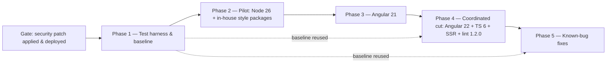

# Modernization Brief: Marush: Space of Care

- **Date:** 2026-11-27
- **Goal:** uplift (same-stack version move), from `INTENT.md`
- **Target:** "Angular 22, Node 26, .NET 10"
- **Inputs:** all dated 2026-11-27. This brief is newer than all of them.

| Input | Time | Input | Time |
|---|---|---|---|
| INTENT.md | 15:02 | topology.json + .mmd | 16:46 |
| PREFLIGHT.md | 15:16 | BUSINESS_RULES.md | 17:28 |
| ASSESSMENT.md | 15:25 | RULE_REVIEWS.json | 20:01 |
| SECURITY_FINDINGS.md | 15:59 | DELTA_CATALOG.md | 20:35 |

## 1. Objective

Marush (marushcare.com) is an ASP.NET Core 10 API with an Angular 20.3 SSR front end. **Angular 20 stops receiving security fixes on 2026-11-28**, and the locked Angular, SSR and Express versions carry 18 runtime advisories (2 critical).

This plan moves the front end to **Angular 22.3, TypeScript 6.0 and Node 26 LTS**. The backend stays on **.NET 10 LTS**: no newer LTS exists, and .NET 11 gains no support time. It also bumps every in-house `@typhoon41/*` package.

The code is already modern (standalone, signals, zoneless), so this is a minimal-diff **Replatform**, not a rewrite. Everything must stay true while it happens:
- The live site keeps running.
- Behavior stays the same, except five known bugs the reviewer chose to fix.
- A security review comes first. It is done; its patch is the entry gate.

## 2. Target architecture

```mermaid
C4Container
  title Marush — end state (same shape as today; versions move)
  Person(customer, "Salon customer", "Books online")
  Person(staff, "Salon staff / owner", "Calendar, clients, booking decisions")
  System_Boundary(iis, "IIS host (test / production)") {
    Container(ssr, "Angular SSR server", "Angular 22.3 · Node 26 · Express 5.3", "Renders sr/en/ru pages; allowedHosts enforced")
    Container(api, "Marush API", ".NET 10 · ASP.NET Core · Autofac · FluentValidation", "Booking, calendar, customers, auth (JWT); starts the SSR process")
  }
  Container(spa, "Browser app", "Angular 22.3 (hydrated)", "Public site + admin")
  ContainerDb(db, "MarushCare database", "SQL Server · EF Core 10", "Appointments, customers, calendar, users")
  System_Ext(smtp, "SMTP server", "MailKit — booking & decision emails")
  System_Ext(captcha, "Google reCAPTCHA Enterprise", "Bot check on booking/login/client writes")
  System_Ext(files, "marushcare.com/files", "Static images & PDFs")
  System_Ext(ado, "Azure Pipelines", "Build (Node 26, .NET 10) → test → approval → prod")
  Rel(customer, spa, "Uses", "HTTPS")
  Rel(staff, spa, "Uses", "HTTPS")
  Rel(spa, api, "JSON over HTTPS")
  Rel(iis, ssr, "IIS rewrite of page routes")
  Rel(api, ssr, "Starts / hosts (NodeJsRunnerService)")
  Rel(api, db, "EF Core")
  Rel(api, smtp, "Sends email")
  Rel(api, captcha, "Verifies tokens")
  Rel(spa, files, "Loads images")
  Rel(ado, iis, "Deploys")
```

| Legacy component | Target component | Change |
|---|---|---|
| Angular 20.3 app (`Site/Gmf.Marush.Care.App`, domains D1–D6) | Same app on Angular 22.3 / TS 6.0 | `ng update` 20→21→22 plus the manual deltas (DELTA-003, -005, -006, -007, -008, -010, -011) |
| Express 5.1 SSR server (`src/server.ts`) | Express 5.3 + `@angular/ssr` 22 with `security.allowedHosts` | Host allowlist (SEC-004, DELTA-005); `trustProxyHeaders` needs a decision (DELTA-006) |
| Node 22.20 (CI) / unknown (IIS host) | Node 26 LTS in CI, on dev machines and on both IIS hosts | DELTA-001, -002, -015 |
| `@typhoon41/eslint-config-angular` 1.1.1, `stylelint-config` 1.1.2, `scss-solutions` 0.2.1 | 1.2.0, 1.2.0, 0.2.4 | DELTA-011, -012, -013 |
| No test harness | SSR smoke characterization plus API contract tests; optional Vitest `@angular/build:unit-test` | DELTA-014 |
| .NET 10 API, Services, Domain, Infrastructure, `Packages/Gmf.*` (D7–D10) | Unchanged on .NET 10. Only the security fixes (SEC-001, SEC-002) and the five known-bug fixes touch it. | DELTA-017: no version bump |
| Azure Pipelines, web.config, Aspire host (D11) | `NodeVersion` 26 pin; CLAUDE.md Node note updated | DELTA-001 |

### Target versions

Checked on 2026-11-27 (`INTENT.md`). Reused here, within the 30-day window.

| Component | Version | Support ends | Checked (source, date) | Status |
|---|---|---|---|---|
| Angular | 22 (22.3.x) | 2028-06-30 | endoflife.date/api/v1/products/angular + npm registry, 2026-11-27 | supported |
| TypeScript | 6.0 (6.0.3) | none published | npm registry (`@angular/compiler-cli@22.3.0` peer `>=6.0 <6.1`), 2026-11-27 | supported (pinned by Angular; TS 7 is not supported by Angular 22.3) |
| Node.js | 26 LTS (26.13.1) | 2029-04-30 | endoflife.date/api/v1/products/nodejs + `@angular/core@22` engines, 2026-11-27 | supported |
| .NET | 10 LTS (10.0.15) | 2028-11-14 | endoflife.date/api/v1/products/dotnet, 2026-11-27 | supported |
| Express | 5.3.0 | none published | npm registry, 2026-11-27 | supported |
| Angular 20 (current) | 20.3.x | **2026-11-28** | endoflife.date, 2026-11-27 | **ends tomorrow**. The security patch moves to 20.3.35/20.3.43 as a stop-gap. |

## 3. Phased sequence

The order is **build-graph leaf-first** with the uplift overrides from `DELTA_CATALOG.md`:
- **The test harness comes first**, because no tests exist (DELTA-014).
- **Angular 22, TypeScript 6, the tsconfig change and the SSR host config are one coordinated cut** (DELTA-001, -003, -004, -005).
- The standalone repo has **no outside consumers** (preflight Check 6), so no shared node needs a transition decision.

**Gate before Phase 1:** `security_remediation.patch` is applied and deployed. It edits the same `package.json` and `package-lock.json` lines `ng update` rewrites, and it is the only source of `allowedHosts`.

**This brief is a hypothesis.** Phase 2 is the pilot. Anything it surfaces is *expected* to revise the brief, and regenerating it after the pilot is the normal path:
- a delta the analysis missed (no `ng build` was run on the scratch copy);
- an IIS or Node host fact;
- a lint-convention clash.

You steer execution by **editing this file**. The build commands honor an edited criterion, but not a chat message. They may tick a box or add a note, but never reword a criterion; they propose changes on a `Proposed revision:` line instead.



#### Phase 1 — Test harness and baseline
Command: /code-modernization:modernize-uplift
Modules: Site/Gmf.Marush.Care.App/src/server.ts, Site/Gmf.Marush.Care.Api/Controllers/AppointmentController.cs, Site/Gmf.Marush.Care.Api/Controllers/CalendarController.cs, Site/Gmf.Marush.Care.Api/Controllers/CustomerController.cs, Site/Gmf.Marush.Care.Api/Controllers/UserController.cs
Scale: M
Risk: Medium. (1) Tests may pin behavior through the wrong seam: put the SSR smoke at the HTTP level, independent of the Angular version, and test the API contracts through the controllers. (2) No database fixtures exist: use the Aspire SQL container with seeded data. The captcha is skipped outside Production.
Entry criteria:
- [ ] `security_remediation.patch` applied, built and deployed to the test environment; `npm audit --omit=dev` shows no critical or high runtime advisory
- [ ] The RULE-030 / SEC-001 conflict is decided (§7) and `RULE_REVIEWS.json` updated
- [ ] First slice named: the SSR smoke for the `sr` locale home route (`/sr/početna`)
Exit criteria:
- [ ] `analysis/marush/BASELINE.md` records, for every route in sr/en/ru: the status, `<html lang>`, title and meta, and the first localized heading. Each is recorded with the production Host and with the localhost Host, against Angular 20.3.
- [ ] Each Behavior Contract rule in §5 has at least one characterization or contract test that passes on the current code
- [ ] The test suite runs in CI (`Deployment/Templates/build.yaml`) and fails the build on a regression

#### Phase 2 — Pilot: Node 26 runtime and in-house style packages
Command: /code-modernization:modernize-uplift
Modules: Site/Gmf.Marush.Care.App/src/styles, Deployment/Templates/build.yaml, Site/Gmf.Marush.Care.Api/Services/NodeJsRunnerService.cs
Scale: S
Risk: Medium. (1) The IIS hosts' Node version is not under pipeline control (DELTA-002): install Node 26 on test first, then on production, and record `node -v` in the deploy log. (2) stylelint 18 renames rules and silently drops smacss ordering (DELTA-012): rename the 5 disable directives; property order is a decision in §7.
Entry criteria:
- [ ] Phase 1 exit criteria all ticked
- [ ] Pilot unit named: `@typhoon41/stylelint-config` 1.2.0 + `@typhoon41/scss-solutions` 0.2.4
- [ ] Node 26 is installed on the test IIS host (confirmed by `node -v` on the host)
Exit criteria:
- [ ] `NodeVersion: 26.x` in `Deployment/Templates/build.yaml`; `@types/node` on 26.x; CLAUDE.md's Node requirement updated
- [ ] `npm run lint:ci` passes with stylelint-config 1.2.0; the compiled breakpoint CSS (`body::before` content mobile/tablet/desktop) is byte-identical to the baseline
- [ ] The Phase 1 suite and the SSR smoke pass on Node 26 against the test environment
- [ ] The pilot playbook for the uplift is written, and this brief is regenerated if the pilot changed any assumption

#### Phase 3 — Angular 21
Command: /code-modernization:modernize-uplift
Modules: dom:D1, dom:D2, dom:D3, dom:D4, dom:D5, dom:D6
Scale: M
Risk: Low to medium. (1) The control-flow migration touches 19 components (DELTA-009): it is mechanical, so review the diff and delete the blank lines. (2) TS stays 5.9 (`@angular/build` 21 peers `<6.0`): do not bump TS early.
Entry criteria:
- [ ] Phase 2 exit criteria all ticked
- [ ] First slice named: `ng update @angular/core@21 @angular/cli@21` on a branch, with `@angular/ssr`/`build` matched
Exit criteria:
- [ ] All `@angular/*` packages are on 21.2.x and TypeScript is still ~5.9
- [ ] `npm run build -- --configuration=production` and `npm run lint:ci` pass in CI
- [ ] The Phase 1 suite and the SSR smoke match `BASELINE.md` with zero differences
- [ ] Deployed to the test environment and spot-checked in a browser (booking form, admin calendar, client list)

#### Phase 4 — Coordinated cut: Angular 22, TypeScript 6, SSR config, in-house lint 1.2.0
Command: /code-modernization:modernize-uplift
Modules: dom:D1, dom:D2, dom:D3, dom:D4, dom:D5, dom:D6
Scale: L
Risk: High. (1) A wrong host allowlist turns every page into a 400 (DELTA-005): verify which Host ARR forwards before the cut, keep `security.allowedHosts` in `angular.json`, and gate the test deploy on the SSR smoke. (2) Two behavior-silent migrations (DELTA-007 single vs double change events; DELTA-008 null vs undefined) plus 107 new lint errors (DELTA-011): review each migrated file, cover type-selector and the hamburger button with characterization tests in Phase 1, and treat lint fixes as no-behavior-change refactors.
Entry criteria:
- [ ] Phase 3 exit criteria all ticked
- [ ] Node 26 is installed on the production IIS host
- [ ] The §7 decisions on ARR Host and `trustProxyHeaders`, lint fix vs tune, and migration-output clean-up are made
Exit criteria:
- [ ] `@angular/*` on 22.3.x, TypeScript ~6.0.3, `baseUrl` removed from `tsconfig.json` with `./`-relative `paths`, and `withFetch`/`withIncrementalHydration` removed
- [ ] `@typhoon41/eslint-config-angular` 1.2.0 installed and `npm run lint:ci` passes with 0 errors
- [ ] Production build passes; `npm audit --omit=dev` has no critical or high advisory
- [ ] The Phase 1 suite and the SSR smoke match `BASELINE.md`, except differences listed and accepted in `analysis/marush/` by the approver
- [ ] Deployed to test and approved through the pipeline's manual gate, then to production. Angular 20 is no longer deployed anywhere.

#### Phase 5 — Known-bug fixes (intended differences)
Command: /code-modernization:modernize-uplift
Modules: Site/Gmf.Marush.Care.Infrastructure/Data/Entities/Calendar/CalendarSlot.cs, Site/Gmf.Marush.Care.Api/Validation/AppointmentRequestValidator.cs, Site/Gmf.Marush.Care.Domain/Models/Customer.cs, Site/Gmf.Marush.Care.Api/Validation/NewCalendarEntryDtoValidator.cs, Site/Gmf.Marush.Care.Infrastructure/Services/AppointmentNotificationService.cs
Scale: M
Risk: Medium. (1) RULE-006 (unify time storage) needs a data migration of the existing `CalendarEntries` and `Appointments` rows: write a reversible EF migration and take a database backup first (the pipeline already backs up the database). (2) Each fix is a deliberate behavior change: write a test for the new rule before changing the code, and keep the rest of the contract unchanged.
Entry criteria:
- [ ] Phase 4 exit criteria all ticked, and production is stable on Angular 22
- [ ] For each of RULE-006, 019, 021, 023 and 046, the intended new rule is written into its §7 open question and ticked by the approver
Exit criteria:
- [ ] Each of the five rules has a test asserting the new behavior, and it passes
- [ ] Every other Behavior Contract test is unchanged and passing
- [ ] `RULE_REVIEWS.json` is updated for the five rules with the new behavior, and `BUSINESS_RULES.md` regenerated

Scale is a relative size against the assessment's complexity index (59.9 for the whole system; the front end is about 60% of it). It is not a duration.

## 4. Business walkthroughs

The .NET backend is not version-migrated. Its steps are covered by the Phase 1 contract tests and stay unchanged, except where Phase 5 fixes a known bug.

**Book an appointment online**: salon customer

| Step | Legacy modules | Replaced or proven in |
|---|---|---|
| Choose treatments, date and time | appointment-page, services-selector, summary | Phase 3 → 4 (Angular) |
| Send the request with a captcha check | appointment (FE), ValidateCaptchaAttribute, AppointmentController | Phase 4 (FE); Gate (SEC-001) |
| Check the request is valid and inside the booking window | AppointmentRequestValidator, AppointmentBookingWindow | Phase 1 contract; **Phase 5** (RULE-019, 021) |
| Save the customer and the requested appointment | Appointment Service, AppointmentRepository, Appointments/Customers tables | Phase 1 contract |
| Email the owner (with Accept/Reject links) and the customer | AppointmentNotificationService, request and submitted templates, SMTP | Gate (SEC-002); **Phase 5** (RULE-046) |
| Show the request-sent page | request-sent-page | Phase 3 → 4 |

**Accept or reject a booking from email**: salon owner

| Step | Legacy modules | Replaced or proven in |
|---|---|---|
| Open the email and click Accept or Reject | appointment-request.html, AppointmentController | Phase 1 contract |
| Record the decision while it is still pending | AppointmentNotificationService, AppointmentRepository | Phase 1 contract |
| Email the customer the outcome | confirmation and rejection templates, SMTP | Phase 1 contract; Gate (SEC-002) |
| Land on the client-notified page | client-notified-page | Phase 3 → 4 |

**Run the weekly calendar**: salon staff

| Step | Legacy modules | Replaced or proven in |
|---|---|---|
| Log in with captcha | login-page, authentication, UserController, UserService | Phase 3 → 4 (FE); Phase 1 contract |
| Load the week grid | calendar-page, calendar, CalendarController, CalendarService, CalendarRetrievalRepository | Phase 3 → 4; Phase 1 contract; **Phase 5** (RULE-006) |
| Add or edit an entry | calendar-entry-dialog, CalendarModificationRepository | Phase 3 → 4; **Phase 5** (RULE-023) |
| Reschedule: raise an event and email the client | AppointmentRescheduled, AuditLoggingService, AppointmentRescheduledHandler, SMTP | Phase 1 contract |

**Look up and update a client record**: salon staff

| Step | Legacy modules | Replaced or proven in |
|---|---|---|
| Search and page through clients | clients-page, clients, CustomerController, CustomerRetrievalRepository | Phase 3 → 4; Phase 1 contract |
| Edit phones, emails and properties | clients-edit-page | Phase 3 → 4; **Phase 5** (RULE-021) |
| Save with captcha | ValidateCaptchaAttribute, CustomerModificationRepository | Phase 1 contract; Gate (SEC-001) |

## 5. Behavior contract

For an uplift, the contract is **the recorded baseline** (`analysis/marush/BASELINE.md` and the result files it points to, written in Phase 1). The new version must reproduce it. It is anchored by these **P0 rules**: every P0 rule except the five marked Wrong. A person confirmed the 17 flagged ones in `RULE_REVIEWS.json`; the remaining 6 P0 rules were High confidence with no open question.

| Rule | What must stay equivalent | Status |
|---|---|---|
| RULE-001 | Online price = sum of the selected catalog prices (browser) | confirmed |
| RULE-002 | Online end = start + summed duration, in server-local (Belgrade) time | confirmed |
| RULE-003 | Server stores the browser's price and duration unchecked | confirmed (keep) |
| RULE-004 | Money decimal(10,2), max 99,999,999.99 | High |
| RULE-005 | A missing end time means 1 hour | High |
| RULE-012 | Prices and durations are fixed in the browser catalog | confirmed |
| RULE-017 | Booking window: today to +1 month, weekdays, server clock | confirmed |
| RULE-030 | Captcha verdict | **blocked**: conflicts with SEC-001 (§7) |
| RULE-031 | Login hash check, audit on success and failure, 400 on failure | confirmed |
| RULE-033 | Slot conflict for admin entries only; online booking unchecked | confirmed (keep) |
| RULE-036 | Returning client matched on email AND phone | confirmed |
| RULE-037 | Anonymous decision GET, date from the URL, fixed Serbian redirects | confirmed (keep) |
| RULE-038 | JWT signed, issuer- and audience-bound, configured expiry | confirmed |
| RULE-039 | Any logged-in user has full access (no roles) | confirmed |
| RULE-041 | User creation only in DEBUG builds | confirmed |
| RULE-042 | Commit unless an exception or invalid model (404, 400 and 302 also commit) | confirmed (keep) |
| RULE-044 | Status set Requested, Rejected, Approved, Performed | High |
| RULE-045 | Online request starts Requested + BookedOnline | High |
| RULE-047 | Decision only from Requested, once | High |
| RULE-049 | Admin entry without a request creates an Approved appointment | High |
| RULE-050 | Placing a request on the calendar keeps it Requested | confirmed (keep) |
| RULE-054 | Deleting an entry hard-deletes the appointment silently | confirmed (keep) |
| RULE-056 | Saving the client card deletes appointments not listed | confirmed (keep) |

Not in the contract, because they are marked Wrong and are intended differences in Phase 5:
- RULE-006: time-storage forms
- RULE-019: online start-time limit
- RULE-021: phone regex
- RULE-023: admin entry dates
- RULE-046: booking email atomicity

The SSR outputs in `BASELINE.md` are also part of the contract: status, lang, title, meta and the localized heading per route and Host.

## 6. Validation strategy

| Phase | Characterization | Contract | Dual-execution diff | Property-based | Manual UAT |
|---|---|---|---|---|---|
| 1 | SSR smoke per route, locale and Host; FE components DELTA-007 touches (type-selector, hamburger button) | API tests for every §5 rule (Aspire SQL, captcha off outside Production) | — (this records the baseline) | Booking window and time grid (RULE-017, 019, 023) over generated dates and times | — |
| 2 | Re-run on Node 26 | Re-run | Compiled CSS (breakpoint `content`) old vs new packages | — | Spot-check styles on test |
| 3 | Re-run | Re-run | SSR HTML diff (Angular 20.3 vs 21) on the baseline routes | — | Booking, calendar and client list on test |
| 4 | Re-run plus the host-allowlist cases (allowed → 200 SSR, forged → 400) | Re-run | SSR HTML diff (Angular 20.3 vs 22); event-count check for DELTA-007 | — | Full UAT of the four walkthroughs on test before the manual approval gate |
| 5 | Re-run (unchanged rules) | New tests for the five fixed rules | Database row comparison before and after the RULE-006 migration | Phone regex over generated strings (RULE-021) | Staff confirm the new behaviors on test |

## 7. Open questions (decide before Phase 1 unless marked)

- [ ] **RULE-030 vs SEC-001:** the reviewer confirmed today's captcha AND logic, but security patch SEC-001 changes it to OR and checks the action on the server. Drop SEC-001, or re-mark RULE-030 as Wrong? This blocks the Gate and Phase 1.
- [ ] **Apply and deploy `security_remediation.patch`** (14 reviewed hunks; Angular 20.3.35/43 stop-gap, captcha, email encoding, `allowedHosts`). Angular 20 support ends 2026-11-28.
- [ ] **Hosts:** does IIS ARR keep the public Host on the rewrite to `localhost:<ssrPort>`, or send `localhost` plus `X-Forwarded-Host`? Is `www.marushcare.com` bound? This decides `allowedHosts` and whether to keep the `trustProxyHeaders` that the v22 migration adds (DELTA-005, -006). *Before Phase 4.*
- [ ] **Node on the IIS hosts:** who installs Node 26 on test and production? Is 26 the host target, or 24.15 LTS? (DELTA-002) *Before Phase 2.*
- [ ] **In-house lint 1.2.0:** fix all 107 new violations, or tune `@typhoon41/eslint-config-angular` first? `inject-at-top` (42 hits) and `prefer-service-decorator` (11 hits) may clash with project conventions. A config change means a toolkit release PR. *Before Phase 4.*
- [ ] **stylelint-config 1.2.0 drops smacss property ordering:** acceptable? (DELTA-012) *Before Phase 2.*
- [ ] **Test harness scope:** SSR smoke plus API contract tests only, or also Vitest through `@angular/build:unit-test`? Remove the stale esproj `JavaScriptTestFramework=Jest`? (DELTA-014)
- [ ] **v22 migration output:** accept as is (the `$safeNavigationMigration` wrapper, `*Input` aliases, `extendedDiagnostics` suppressions), or clean up in the same cut? Is the change event firing once instead of twice (DELTA-007) an accepted difference? *Before Phase 4.*
- [ ] **RULE-006 (Wrong): unify time storage.** Which single form (UTC plus Europe/Belgrade?), and may the existing entry rows be migrated? *Before Phase 5.*
- [ ] **RULE-019 (Wrong):** is the last online start 20:00 (as the form shows), and must a booking end by closing time? *Before Phase 5.*
- [ ] **RULE-021 (Wrong):** anchor the server phone regex to `^(?:06\d{7,8}|\+\d{10,13})$`, as the browser does? *Before Phase 5.*
- [ ] **RULE-023 (Wrong):** block admin entries on Sundays only, or also on days with a NonWorkingDay note? Past dates too? *Before Phase 5.*
- [ ] **RULE-046 (Wrong):** send the customer email before the owner's, or save first and send both after the commit? What happens to the owner's links if the customer email fails? *Before Phase 5.*
- [ ] **Push and PR:** this branch (`worktree-modernize-marush`) exists locally only; earlier pushes were blocked by the permission check. Push it so the plan is reviewable?

## 8. Approval

```
Approved by: ________________  Date: __________
Approval covers: Phase 1 only | Full plan
```
